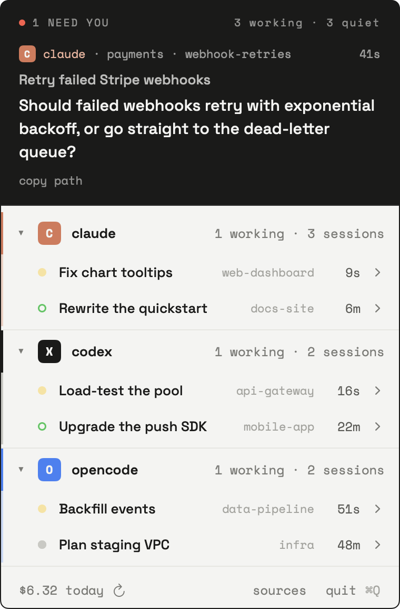

<p align="center"></p>

# Argus

[](https://github.com/BasharIQ/argus/actions/workflows/check.yml)

A macOS menu bar app for people who run several coding agents at once.

Argus had a hundred eyes. You have five terminals.

<p align="center"></p>

Argus reads local Claude Code, Codex, OpenCode, and Pi sessions. It shows their working directory, activity, and daily cost in one menu bar panel. Explicit questions appear in an attention inbox and trigger native notifications. Unresolved questions stay visible across midnight.

## Why

Running one agent is easy. Running five is a tab-hunting problem: one is waiting for a yes, one finished ten minutes ago, one has been retrying the same failing test for a while, and you don't know which is which until you check each terminal. It gets worse when the sessions are spread across different harnesses and different machines. Argus turns all of that into a glance.

## Supported harnesses

| Harness | Sessions | State | Answer prompts | Cost |
|---|---|---|---|---|
| Claude Code | yes | yes | planned | yes |
| Codex | yes | yes | planned | yes |
| OpenCode | yes | yes | planned | yes |
| Pi | yes | yes | planned | yes |

Each harness has an adapter that reads its session data and reports sessions and source health. No adapter currently delivers prompt answers.

## What it shows

- Sessions used today, recent working sessions, and unanswered questions, grouped by harness
- State per session: working, needs input, idle, finished, errored
- The current tool call, or the question the agent is asking
- Daily cost per session and across harnesses
- Session title, repository, working directory, model, and branch when recorded
- Dismiss a quiet session (hover, then ✕) until it is used again; working or needs-input sessions can't be dismissed
- Hidden sessions can be restored individually or together
- Source health distinguishes a missing installation, a readable empty source, and a failed or incomplete scan

## What it does

- Native notifications when a session needs you or finishes
- Copy a session's working directory
- Retry scans and inspect notification permission status

## Planned

- Answer prompts from the panel, so you can reply to a waiting agent without switching to its terminal
- Open the exact session in its terminal or editor, from the panel or a notification
- Show git worktree status per session, and remove worktrees whose branches are merged
- Watch sessions on remote machines over SSH

## How it works

Argus polls the files and database the harnesses already write every five seconds. It does not proxy the model API or change harness configuration. Claude transcripts come from `~/.claude/projects`, Codex from `~/.codex/sessions`, Pi from `~/.pi/agent/sessions`, and OpenCode from `~/.local/share/opencode/opencode.db`.

A pending tool call does not prove that a permission prompt is on screen. Argus only reports needs-input state when it finds explicit question evidence. Ordinary permission waits without such evidence are not detected. Generic pending tools become idle after 30 minutes without transcript activity. Explicit running-tool records remain working. Completion still uses a quiet-period heuristic.

Claude Code and Codex subagents count toward their parent session. A session stays working while any of its subagents is working, even when the main transcript has gone quiet, and subagent token usage adds to the session's cost.

Working sessions can carry across midnight when their last activity is within 24 hours. Older running records are omitted because a persisted tool status does not prove the process is still alive. Explicit unanswered questions remain visible regardless of age.

Claude and Codex costs can be estimates from token usage. Pi and OpenCode use recorded costs. Failed sources retain visibly stale sessions, and incomplete scans mark spending as incomplete. Older inactive transcripts are screened from their final records, so source health does not validate every historical record.

## Privacy

Argus makes no network requests. It reads harness files and writes nothing back to them. It stores its own preferences, such as dismissed sessions and collapsed sections, in macOS user defaults, and caches notification badge images in the system temporary folder.

## Non-goals

- Not an agent runner or scheduler; it observes sessions you started
- Not a diff reviewer
- No accounts, no telemetry, no cloud

## Install

Argus has no prebuilt release yet. Build it from source.

Argus runs on macOS 14 or later and needs at least one supported harness installed locally. To build it, you need Xcode 16 or later, or the matching Command Line Tools. To get the Command Line Tools without Xcode, run `xcode-select --install`. Builds with Xcode 26 or later also keep the panel anchored to the menu bar while it resizes on macOS 26.

1. Clone the repository:

	```sh
	git clone https://github.com/BasharIQ/argus.git
	cd argus
	```
2. Build the app bundle:

	```sh
	sh scripts/make-app.sh release
	```

	The script prints `Built build/Argus.app` when it finishes.
3. Copy the app to your Applications folder and open it:

	```sh
	cp -R build/Argus.app /Applications/
	open /Applications/Argus.app
	```

The Argus icon appears in the menu bar. Argus has no Dock icon. On first launch, macOS asks whether Argus can send notifications. Allow them, so Argus can tell you when a session needs input or finishes.

If you decline, the panel footer shows **alerts off**. To turn notifications on later, click **alerts off**, and then click **settings**.

## Development

- `sh scripts/check.sh` runs the transcript, adapter, notification, and application-state checks. The project uses a small test harness in `Tests/ArgusTests/` instead of XCTest, so the checks also run with only the Command Line Tools.
- `sh scripts/make-app.sh debug` builds `build/Argus.app` in debug mode. Debug builds log each scan to stderr. Native notifications work only from the app bundle, not from `swift run ArgusApp`.
- `sh scripts/make-screenshot.sh` renders the panel with sample sessions to `docs/screenshot.png`. Run it after changing the panel's look.
- `sh scripts/make-check-preview.sh` builds `build/ArgusChecks.app`, which shows the panel with fixture sessions and isolated preferences.

Each harness has one adapter in `Sources/ArgusCore/`. To add a harness, write a type that conforms to `HarnessAdapter`, add it to the default `adapters` list in `Sources/ArgusApp/SessionStore.swift`, and add a test file with generated fixtures next to `Tests/ArgusTests/ClaudeCodeAdapterTests.swift`.

## Contributing

Issues and pull requests are welcome. Run `sh scripts/check.sh` before you open a pull request, and add a check for any new adapter behavior.

## License

Argus is released under the [MIT License](LICENSE). The bundled Space Grotesk and Space Mono fonts are licensed under the SIL Open Font License 1.1. Their license texts are in `Sources/ArgusApp/Resources/Fonts/`.
